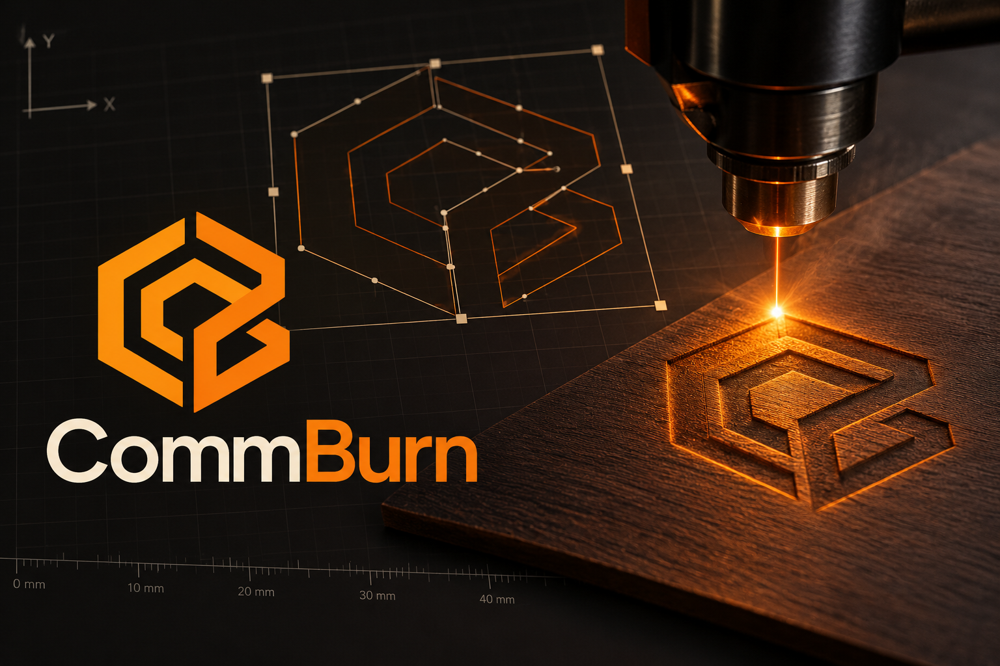

# CommBurn

Editor vetorial em desenvolvimento para preparar trabalhos a laser, com milímetros como unidade canônica e origem/eixos controlados explicitamente pelo usuário. O mesmo núcleo de documentos atende ao editor no navegador, ao app desktop e à CLI; o foco é um fluxo aberto e automatizável, não substituir o controle de segurança da máquina.

> **Atenção:** o envio por serial para controladores GRBL é experimental. Confira origem, área de trabalho e parâmetros da máquina; faça o primeiro ensaio sem material e com o laser desativado. O CommBurn não substitui proteções físicas, intertravamentos nem parada de emergência. O botão de pausa envia *feed hold* e não é uma parada de emergência.

[Política de privacidade](PRIVACY.md)

## Licenças

A licença AGPL-3.0-only do núcleo, adotada a partir da versão `0.1.2`, é uma escolha intencional para manter as obrigações de copyleft também quando uma versão modificada é oferecida como serviço pela rede. Isso não altera as versões já publicadas: até `0.1.1` continuam sob MIT; `0.1.2` em diante usa AGPL-3.0-only.

Plugins independentes podem ter licenças próprias; consulte [LICENSE-PLUGINS](LICENSE-PLUGINS) e o [contrato de CLI e plugins](docs/PLUGIN_CLI_CONTRACT.md). A licença de um plugin não relicencia o núcleo, e a licença aplicável a uma distribuição combinada depende da relação entre os componentes. O plugin "Tema Escuro" em `plugins-proprietary/editor-theme` é uma exceção: tem licença proprietária do titular (todos os direitos reservados), que permite uso gratuito apenas em distribuições oficiais do CommBurn e proíbe venda ou distribuição comercial por terceiros. Ele é incluído somente no pacote MSIX oficial e nos instaladores de teste para Windows; as builds padrão (`npm run dist`) não o contêm.

## Experimentar

- Abra `index.html` em um navegador moderno.
- Execute `npm install` e `npm start`; acesse `http://127.0.0.1:4173` para habilitar a conexão serial experimental com controladores compatíveis com GRBL.
- Execute `npm test` para rodar os testes do núcleo e da CLI.
- Exporte um documento JSON para SVG com `node cli/commburn.mjs entrada.json saida.svg`.
- Baixe os pacotes publicados em [Releases](https://github.com/Mauricio-MN/CommBurn/releases).

## Desenvolvimento local no Windows

- Execute `scripts/setup-local.cmd` uma vez para baixar o Node.js portátil e instalar as dependências do lockfile.
- Execute `scripts/dev-shell.cmd` para abrir um PowerShell com Node.js e as variáveis de ambiente locais configuradas.
- As ferramentas e o cache ficam em `.tools/`, e as dependências do projeto em `node_modules/`; essas pastas são ignoradas pelo Git. Nada é adicionado ao PATH permanente nem instalado globalmente.
- No terminal aberto, use `npm test`, `npm start` ou os demais scripts do projeto.

## Compatibilidade de projetos editáveis

**TABU:** nunca descartar, reinterpretar, arredondar ou rasterizar dados de um projeto editável para fazê-lo carregar. Mudanças no schema exigem nova versão, conversões explícitas e fixtures de regressão que provem preservação do modelo e da aparência. SVG visual é preservado como referência; para obter vetores, reimporte o SVG pelo modo editável. Consulte o [contrato do formato e das conversões](docs/PROJECT_FORMAT.md).

## Aplicativo desktop

- Execute `npm run desktop` para abrir o CommBurn em uma janela desktop durante o desenvolvimento; esse modo usa o mesmo host de plugins locais dos pacotes.
- O GitHub Actions executa os testes automaticamente em pushes para `main` e pull requests direcionados a `main`. A criação de pacotes de lançamento é manual.
- Para criar builds versionados:
  1. Atualize a versão, por exemplo, com `npm version 0.1.2 --no-git-tag-version` (isso altera `package.json` e `package-lock.json`, sem criar uma tag).
  2. Envie essa alteração para `main` com seu fluxo normal de commit e push.
  3. No GitHub, abra **Actions → Desktop release → Run workflow**, selecione `main`, informe `0.1.2` (sem `v`) e inicie.
  4. Quando a execução terminar com sucesso, a GitHub Release `v0.1.2` terá os instaladores de Linux, Windows e macOS com a licença AGPL incluída.
- A publicação inclui instalador `.msi` e executável portátil `.exe` para Windows, `.dmg` e `.zip` para macOS, e `.AppImage` e `.deb` para Linux. As builds macOS ainda não são assinadas nem notarizadas; isso requer certificados e credenciais Apple configurados como secrets do repositório.
- Para gerar um `.msix` versionado, use a mesma versão já enviada para `main` e abra **Actions → Build MSIX → Run workflow**. Escolha `main`, informe a versão (por exemplo, `0.1.2`) e o canal (`store` ou `local`) e inicie. Ao terminar, baixe `commburn-msix-v0.1.2-<canal>` na seção **Artifacts** da execução. O arquivo fica disponível por 90 dias e não é adicionado à GitHub Release.
- `store`: usa a identidade e o publisher reservados no Partner Center, para envio à loja (a Store assina o pacote).
- `local`: usa o publisher `CN=CMBRN - Software`, para ser assinado localmente com um certificado de mesmo subject. Também é possível executar `npm run dist:msix` localmente no Windows.

### Plugins no desktop

O app Electron carrega plugins locais confiáveis da pasta `plugins` dentro do diretório de dados do usuário. Os caminhos padrão são `%APPDATA%\\commburn\\plugins` no Windows, `~/Library/Application Support/commburn/plugins` no macOS e `${XDG_CONFIG_HOME:-~/.config}/commburn/plugins` no Linux. Cada plugin usa um subdiretório com `manifest.json` e um `plugin.mjs`; consulte o contrato de CLI e plugins para o formato/API v1. Feche e reabra o app depois de instalar ou remover um plugin. `npm start` e o editor aberto diretamente no navegador não carregam plugins externos.

O editor renderiza texto nativo em SVG usando as fontes do sistema (Windows, macOS, Linux, Android, iOS) e exporta apenas o nome da fonte, sem incorporar arquivos de fonte. Para G-code, o GRBL usa os contornos das fontes DejaVu incluídas (`sans-serif`, `serif` ou `monospace`); fontes de sistema aparecem na tela, mas o envio recusa o texto com aviso explícito. A operação `fill` aplica o algoritmo e o espaçamento da camada, enquanto `engrave` e `cut` percorrem os contornos. Retângulos e paths vetoriais editáveis sem transformações também são aceitos. SVGs podem ser reimportados como vetores por cor ou pela cor da camada ativa. SVGs visuais preservam a aparência como referência e não são rasterizados para gerar trajetórias. Confira as limitações e precauções de hardware em [docs/PROJECT_GUIDE.md](docs/PROJECT_GUIDE.md). O contrato de automação, plugins e GRBL está em [docs/PLUGIN_CLI_CONTRACT.md](docs/PLUGIN_CLI_CONTRACT.md).

Para módulos de interface, ferramentas, atalhos, geometria e pontos de extensão, consulte [docs/UI_ARCHITECTURE.md](docs/UI_ARCHITECTURE.md).

O app oferece inglês e português brasileiro pelo seletor de idioma; a preferência fica salva no navegador. A CLI aceita `--locale en|pt-BR` ou `COMMBURN_LOCALE` (com `LANG` como fallback). Plugins desktop podem declarar catálogos locais no manifesto e acessar `context.i18n`. A cobertura das strings da interface ainda está em andamento. Consulte a [arquitetura e o estado da internacionalização](docs/INTERNATIONALIZATION_PLAN.md).
